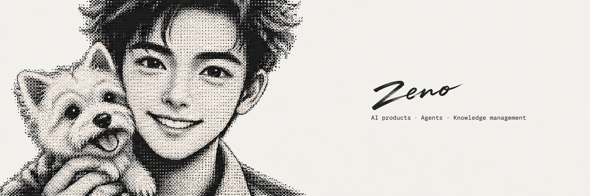

  

# Zeno ZhangXun

AI products · Agents · Knowledge management  
Independent developer · data engineering

## Projects

| Project | Focus |
| :--- | :--- |
| [LearnFlux](https://github.com/zhangxun-ai/LearnFlux) | AI learning workspace |
| [Hongyan · 红研](https://github.com/zhangxun-ai/Hongyan-extension) | Content research for creators |
| [web-clipper](https://github.com/zhangxun-ai/web-clipper) | Web & document archiving |
| [obsidian-social-publisher](https://github.com/zhangxun-ai/obsidian-social-publisher) | Content creation in Obsidian |
| [video-transcript-assistant](https://github.com/zhangxun-ai/video-transcript-assistant) | Video transcripts & AI summaries |

## Services

- **Codex & Claude Code** — 1:1 guidance on your project
- **Product consulting** — From idea to launch
- **Knowledge bases** — Setup & management with Obsidian and Feishu
- **Agent consulting** — Custom Agents for your needs
- **AI certification coaching** — Preparation & guidance
- **Communities & networking** — Recommendations & peer connections

## Contact

[zhangxun.org](https://zhangxun.org) · [xunzhang.ai@gmail.com](mailto:xunzhang.ai@gmail.com)

📍 Shenzhen · Hong Kong  
